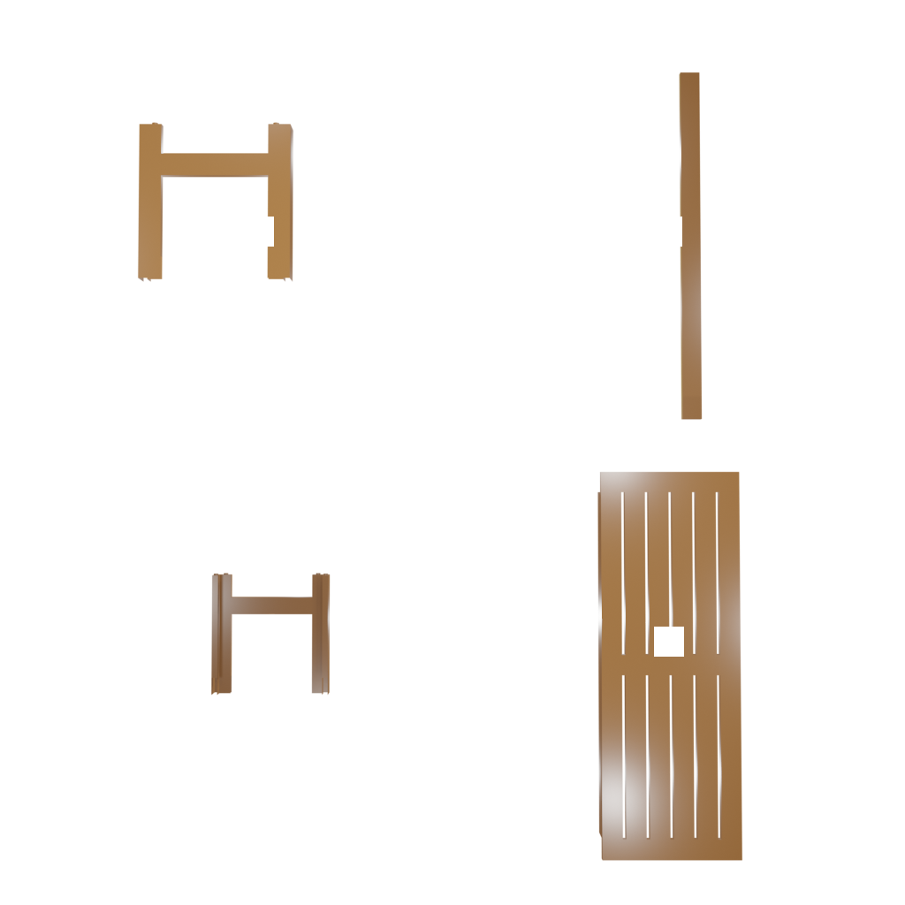

# AssemState

**Manual and Physical-State-Guided Reasoning for Zero-shot Furniture Assembly**

[Paper · arXiv:2610.08446](https://arxiv.org/abs/2610.08446) · [Project page](https://assemstate.wirymouse1.chatgpt.site) · [中文说明](README.zh-CN.md) · [Evaluation protocol](docs/PROTOCOL.md) · [Data preparation](docs/DATA.md)

**Zhiyuan Qi, Jierui Li, Yifan Shen, Cheng Qian, Jiateng Liu** · 2026

AssemState studies manual-grounded assembly hierarchy recovery and target-free 6D pose refinement through rendered after-state feedback. It uses pretrained vision-language models without task-specific training.

This public release includes the **anchor-v2m tree planner**, a maintained visual pose agent, preserved paper prompts, seven archived pose/release settings, and code to reconstruct their aggregate results. The project page includes all main/appendix tables, seven paper figures, and five illustrative **Bench/applaro** input images. **Furniture meshes and the full dataset are not uploaded.**

## Quick start: reproduce archived tables

```bash
git clone https://github.com/togekiss0603/AssemState.git
cd AssemState
python scripts/reproduce_tables.py
```

This command uses only Python's standard library. It checks and reaggregates **1,701 pose/release record pairs** (7 settings × 243 operations), then writes `outputs/tables/{tables.md,summary.csv,summary.json}`. It does not call a model or rerun physics simulation.

| Archived setting | Judge accepted | Mean CD | Release stable |
|---|---:|---:|---:|
| GPT structured | 0/243 | 5.4111 | 90/243 |
| GPT self-check | 13/243 | 1.7744 | 96/243 |
| Haiku structured | 11/243 | 10.8826 | 82/243 |
| Haiku self-check | 28/243 | 10.6708 | 82/243 |

PA@0.01 is zero for every archived setting. The manuscript labels GPT rows “GPT-5”; a preserved historical trace uses `gpt-5.2`. GPT structured and self-check share only 160/243 exact operation contexts, so their comparison is not a fully matched ablation.

## Install inference dependencies

Tested with Python **3.10** on Linux x86-64. CPU rendering is supported; the API-based inference code does not require local model weights.

```bash
python3.10 -m venv .venv
source .venv/bin/activate
python -m pip install -r requirements-lock.txt
python scripts/verify_release.py
python -m unittest discover -s tests -v
```

The lockfile pins the tested environment. Tests requiring unbundled data are explicitly skipped; the record audit, corruption checks, hierarchy comparison and no-key behavior are checked offline. `requirements.txt` lists direct dependencies.

## Real input example: Bench/applaro



The sample has four rigid parts and two annotated steps. Its **reference** tree is `[[0,1,2],3]`; it is not a model prediction. The [project page](https://assemstate.wirymouse1.chatgpt.site/#example) lets you inspect the numbered scene, rotated view, manual preview, and both numbered step masks, with their source paths and consuming stages. Image provenance is recorded in `website/assets/PROVENANCE.json`.

These five images are illustrative, not a complete inference dataset. See [THIRD_PARTY.md](THIRD_PARTY.md) for attribution.

## Live tree inference

Prepare your own data using [docs/DATA.md](docs/DATA.md), then configure credentials:

```bash
cp .env.example .env
# Edit .env to set your own OPENAI_API_KEY, then:
source .env
python scripts/run_tree.py --data-root /path/to/assemblydata \
  --model gpt-5 --names Bench/applaro
```

`run_tree.py` wraps `run_anchor.py` with the fixed combination:

```text
--prompt_version v2m --prompt_type numbered --convert_prompt tree_ikea_manual
```

The actual planning prompt is `planning_anchor_v2m.txt`, unchanged from the supplied manuscript. Stage 1 associates part IDs with names, then enriches descriptions using the manual pages. Stage 2 receives the part table, one numbered scene and the ordered precomputed numbered masks. Conversion tries a structured parse before falling back to a text-only model request.

Outputs go to `outputs/tree/anchor_v2m/<category>/<name>/`, including `tree.json`, `eval_result.json`, and debug stage outputs. `success` in the evaluator means exact hierarchy match, not physical assembly success. The preserved evaluator ignores sibling order and considers annotated equivalent-part permutations for fewer than nine parts.

Use `--all` to run all records in your data root. Existing tree and Stage-2 outputs are reused; pass `--output outputs/new_run` for a separate run. Model resolution is stage-specific environment variable, then `OPENAI_MODEL`, then `--model`. `OPENAI_BASE_URL` optionally selects an OpenAI-compatible endpoint. Real inference incurs API usage and may differ from historical outputs.

## Maintained pose agent

After preparing meshes, image inputs and semantic stage outputs:

```bash
python pose_estimation/visual_agent/run.py \
  --data-root /path/to/assemblydata \
  --manual2skill-output /path/to/stage_outputs \
  --category Bench --name applaro \
  --model gpt-5.2 --path-samples 1 --max-iters 3 \
  --proposer-input-mode current_only_orthographic \
  --output-dir outputs/pose_live
```

The stage-output root must contain `<category>/<name>/stage1_output.json` and `stage2_output.txt`; optional tree/atomic-contract files define the operation interface. You can point it at `outputs/tree/anchor_v2m` after tree inference.

For a CPU software smoke test with your own data, add `--dry-run --max-iters 1 --render-width 256 --render-height 256 --num-views 4`. This explicitly uses a mock client and records `used_vlm=false`. Missing API credentials never silently enable mock inference. A mock rejection is not an assembly success.

**This maintained agent is not the exact historical three-round benchmark runner.** Its evaluator/proposer schedule, multi-path selection and failure propagation differ; it does not implement the historical per-operation GT-reset protocol. Three iterations alone do not reproduce that protocol. Optional Isaac Sim support is not the archived AABB release evaluator and has not been validated in this release.

## Reproduction boundaries

| Component | Status |
|---|---|
| Archived pose/release table reconstruction | Available directly after clone; no assets/API needed |
| Anchor-v2m inference | Runnable with user-provided data and API access |
| Maintained pose inference | Runnable with user-provided data, semantic outputs and API access |
| Full historical tree P/R/F1/EM from saved predictions | Historical v2m/no-anchor prediction sets are incomplete |
| Exact historical pose/release rerun | Original runner and full independent Judge/support-view prompts were not recovered |

The tree evaluation conditions on **precomputed numbered masks**. The pose evaluation conditions on **correct operations and preceding states** across 55 products/243 operations; it is not an end-to-end rollout from predicted trees. Predictions are scored before a ground-truth reset constructs later context. Target poses are not model inputs. See [known discrepancies](docs/PROTOCOL.md#known-discrepancies), including the unresolved tree-table P/R/F1 aggregation issue.

## Paper / code alignment

The four runtime tree prompts match the paper's raw M1–M4 snapshots byte for byte. The appendix introduces only documented display substitutions in two prompts. Historical pose prompts are preserved as snapshots; they are not the current maintained agent's runtime prompts. The complete historical Judge request is unavailable, as stated in the appendix.

See the [full correspondence audit](docs/PAPER_ALIGNMENT.md), or run `python scripts/audit_paper_alignment.py`. Add `--paper-zip /path/to/manuscript.zip` to compare against a supplied source archive. This check requires only Python's standard library.

## Layout

```text
tree/vlm_planner/       Original v2m inference and four prompts
pose_estimation/        Maintained visual agent and JSON/image helpers
artifacts/pose/         Archived per-operation records for seven settings
artifacts/paper_prompts/ Preserved manuscript prompts and illustrative responses
scripts/               Inference wrapper, data preparation, table and integrity checks
tests/                 Offline checks; asset-dependent tests are optional
website/               Project page, paper figures and five authorized sample images
docs/                  Protocol, provenance, data preparation and attribution
```

`RELEASE_MANIFEST.json` hashes distributed files. After intentional edits, run `python scripts/verify_release.py --refresh`. Original imported-file hashes are separately recorded in `docs/source_manifest.json`.

## Attribution

Built on Manual2Skill and IKEA-Manual-derived inputs. The inherited Apache-2.0 code license is retained in [LICENSE](LICENSE). Third-party sample images retain their original rights and are not relicensed under Apache-2.0. See [THIRD_PARTY.md](THIRD_PARTY.md).

## Citation

```bibtex
@misc{qi2026assemstate,
  title={AssemState: Manual and Physical-State-Guided Reasoning for Zero-shot Furniture Assembly},
  author={Zhiyuan Qi and Jierui Li and Yifan Shen and Cheng Qian and Jiateng Liu},
  year={2026},
  eprint={2610.08446},
  archivePrefix={arXiv},
  primaryClass={cs.AI},
  url={https://arxiv.org/abs/2610.08446}
}
```
